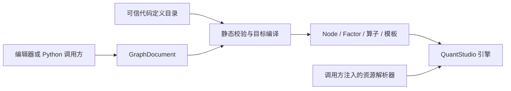

# 可持久化计算图

`QSExt.Graph` 将编辑中的图文档编译为 QuantStudio 对象。Python、CLI、MCP 和 QSWeb 可以共用这一层；图模块不依赖 QSWeb、FastAPI、Neo4j 连接或任务调度器。

图文档允许保存不完整构图对象。算子 `bind` 的出口始终是算子，`apply` 的出口始终是因子；节点 `template` 的出口始终是 `NodeTemplate`，`build` 的出口是完整节点。输入是否已经补全不会改变出口类别。



## 模块边界

| 模块 | 职责 |
| --- | --- |
| `Protocol.py` | 图文档、绑定值、类型描述、资源描述和诊断；只依赖标准库及 Pydantic |
| `Metadata.py` | Python 类型、Pydantic 字段到传输元信息的显式转换 |
| `Definitions.py` | 按稳定 ID 和行为版本注册代码定义及构造器 |
| `Compiler.py` | 无业务实例化的静态校验、选定输出的闭包构造、来源映射 |
| `Resources.py` | 资源语义目录、运行作用域解析器及既有连接池适配 |
| `Sources.py` | 在执行阶段解析和读取外部因子的叶子节点 |
| `Nodes.py` | 执行阶段的普通节点结果投影 |
| `Templates.py` | 绑定算子和节点模板的 JSON 配方导入、导出及插入 |
| `api.py` | 公开 Python 接口 |
| `QSExt.QSRegistry.GraphStore` | 可选的定义描述及模板配方存储适配 |

安装环境要求 Python 3.12+、Pydantic 2 和当前分支的 QuantStudio 核心接口。单独导入 `QSExt.Graph.Protocol` 不加载 QuantStudio 或数据库组件。

## 图协议

文档只有一份权威连接数据：`blocks[*].inputs` 中的引用。GUI 连线可以从引用派生，不应另存可独立修改的 `edges`。

```json
{
  "schema_version": 1,
  "blocks": [
    {
      "id": "add-left",
      "definition": {"id": "qs.factor.Add", "version": 1},
      "operation": "bind",
      "inputs": {"x0": {"kind": "literal", "value": 3}}
    },
    {
      "id": "sum",
      "definition": {"id": "qs.operator.apply", "version": 1},
      "operation": "apply",
      "inputs": {
        "operator": {"kind": "reference", "block": "add-left", "port": "result"},
        "x1": {"kind": "literal", "value": 4}
      },
      "result_args": {"Name": "求和"}
    }
  ],
  "outputs": {"main": {"kind": "reference", "block": "sum", "port": "result"}},
  "extensions": {"qsweb": {"positions": {"add-left": [0, 0], "sum": [200, 0]}}}
}
```

`definition.version` 是组件行为版本。`schema_version` 是图传输格式版本。模板还有独立的模板版本；目录不会自动把文档中的版本替换为最新版本。

`args` 配置定义本身；对算子而言是算子的参数。`result_args` 仅用于 `apply`，传递给所生成因子的 `factor_args`。报告节点、回测节点等普通节点的名称及参数直接放在 `args`。

### 输入绑定

| 表示 | 语义 |
| --- | --- |
| 没有这个输入键 | 尚未显式绑定，可以使用模型默认值 |
| `{"kind":"literal","value":null}` | 显式绑定 `None`，需要槽位允许空值 |
| `{"kind":"reference","block":"a","port":"result"}` | 使用画布对象的构造出口 |
| `{"kind":"resource","id":"db://prices"}` | 使用资源的语义描述，在来源节点执行时才取得句柄 |
| `{"kind":"collection","items":[...]}` | 有顺序的成员集合；成员 ID 在移动和重新排序后保持稳定 |

集合成员的 `value` 可以省略，表示 GUI 占位。占位不会计入已绑定成员数。`bind` 和 `template` 可以保留占位；构造完整目标时，占位会产生带 `member_id` 的错误。

```json
{
  "kind": "collection",
  "items": [
    {"id": "member-a", "value": {"kind": "reference", "block": "factor-a"}},
    {"id": "member-b"},
    {"id": "member-c", "value": {"kind": "reference", "block": "factor-a"}}
  ]
}
```

重复引用是合法的两条依赖边，编译时保留共享对象和每个成员的位置。集合成员 ID 只要求在同一个集合内唯一；画布对象 ID 在整个文档中唯一。文档和画布对象的 `extensions` 原样保留，由各应用解释。

当前每个构图对象只有 `result` 出口。因子复合字段通过核心 `Fetch` 算子选择；普通节点的结果通过 `qs.node.select` 选择，其 `args.Path` 是字符串或整数组成的路径，执行阶段才访问结果。

## 定义目录与元信息

```python
from QSExt.Graph.api import create_default_registry

registry = create_default_registry()
descriptor = registry.describe_definition("qs.factor.Add")
print(descriptor.model_dump_json(indent=2))
```

默认目录包含无需额外必填构造形参的核心算子、常用扩展算子、常量来源、延迟资源来源、结果投影和时序相关性结果节点。核心算子 ID 使用 `qs.factor.<类名>`，扩展算子使用 `qsext.factor.<类名>`，大小写保留。类名发生改变时，需要明确维持原 ID 或发布新的定义。

下面的定义有固定用途：

| 定义 | 操作 | 出口 |
| --- | --- | --- |
| `qs.factor.constant` | `build` / `template` | 数据因子 / 数据因子模板 |
| `qs.factor.source` | `build` | 延迟读取资源的因子 |
| `qs.operator.apply` | `apply` / `bind` | 因子 / 新的绑定算子 |
| `qs.template.build` | `build` / `template` | 节点 / 新的节点模板 |
| `qs.node.select` | `build` / `template` | 结果投影节点 / 模板 |

`qs.operator.apply` 和 `qs.template.build` 的完整输入声明取决于上游配方。GUI 使用 `describe_block(document, block_id, registry)` 获得展开后的槽位和绑定状态；使用 `describe_definition` 获得静态组件目录。

`TypeDescriptor.kind` 描述对象类别，例如 `factor`、`node`、`operator`；`data_type` 单独描述计算结果数据类型。无法静态推断的数据类型保持 `None`，不为推断元信息执行计算。参数模型的嵌套字段放在 `members` 中，保留标题、描述、默认值、数量约束和数值约束；`fields` 提供简洁的字段到类型映射。

默认工厂不会在目录查询或静态校验时执行。默认值本身不能表示为 JSON 时，`default_available` 为假。callable 和未注册的 Python 类型标记为 `python` 且 `persistable=False`。这些参数应由可信注册工厂注入，或通过应用认可的稳定函数 ID 做适配；图文档不能携带导入路径、Python 代码、pickle 或 dill。

### 注册自定义节点和算子

```python
registry.register_node("research.my_node", MyNode, version=1)
registry.register_operator("research.my_operator", MyOperator, version=1)
```

节点需要使用 `__QS_DepClass__` 和 `__QS_ArgClass__` 声明完整状态，并支持核心 `template` / `from_dependencies` 入口。构造器及 `_QS_post_bind` 不能做 IO；IO 放入执行准备或计算阶段。

有额外构造形参的算子可以提供工厂：

```python
registry.register_operator(
    "research.ts_corr",
    CalcTimeSeriesCorrelation,
    factory=lambda args: CalcTimeSeriesCorrelation(descriptor_ids=section_ids, args=args),
)
```

工厂由应用或扩展代码注册。外部连接、固定业务配置等不由文档指定任意 Python 路径。需要独立参数模型的脚本定义、DefModule、FactorDef 或组合构造器，可以使用 `register_factory`：

```python
registry.register_factory(
    "research.custom_builder",
    args_model=CustomArgs,
    input_model=CustomInputs,
    output=TypeDescriptor(kind="factor", type_id="qs.factor"),
    builder=build_factor,
)
# build_factor(block, args, inputs) 只组装已有组件。
```

完整工厂构造时，编译器验证模型并补齐默认值，再传递参数和已解析输入。静态校验不调用工厂。当前图连边以单值和有序集合为主；需要映射型因子输入的业务算子，可用可信工厂将有序集合转换为业务映射，应用自行提供键的参数模型。

## 静态校验与目标编译

```python
from QSExt.Graph.api import GraphDocument, compile_graph, validate_graph

document = GraphDocument.model_validate_json(saved_json)
diagnostics = validate_graph(document, registry)
compiled = compile_graph(document, registry, targets=["main"])
factor = compiled.outputs["main"]
```

`validate_graph` 默认检查整个画布，缺失参数、必需输入及集合占位作为草稿警告。传入 `targets` 后只检查目标依赖闭包；`allow_partial=False` 要求 `build` / `apply` 完整，`bind` / `template` 仍允许部分配置。

`compile_graph` 默认只构造所有已声明输出的闭包。传入 `targets` 可只编译一部分输出。无关的未完成对象、未注册定义或坏引用不会阻止这个目标。引用、出口、操作、循环、类型和数量错误会阻止相关目标构造。参数模型的完整验证及模型级约束在实际构造时执行。

重新编译会产生新的核心实例；语义相同的节点保留相同 QSID，运行实例的 InstanceID 不同。文档 ID、定义 ID、核心 QSID 和 InstanceID 各有职责。

错误通过 `GraphError.diagnostics` 返回。每个 `Diagnostic` 包含 `code`、`severity`、`block_id`、`path`、`member_id` 和中文消息。协议本身的格式错误由 Pydantic `ValidationError` 表示；应用可以将其转换为自身请求校验响应。

```python
try:
    compiled = compile_graph(document, registry, targets="main")
except GraphError as error:
    payload = [item.model_dump(mode="json") for item in error.diagnostics]
```

### 执行与画布事件定位

```python
nodes = compiled.execution_nodes()
result_list = engine.run(nodes, context, fwd_data_list=requests)
```

`execution_nodes()` 要求全部输出是完整 Node。算子和模板可以编译和导出，但不能提交引擎执行。因子运行使用 `FactorContext`、`FactorLocalContext` 和对应初始化请求。

`compiled.source_map` 记录 `(block_id, port, instance_id, role)`。`result` 角色表示该对象直接构造的节点，`dependency` 表示其依赖闭包中的节点。一个对象可以展开为多个节点，同一个节点也可以映射到多个对象。GUI 可按角色选择自身状态或依赖进度；`blocks_for_instance` 返回与引擎事件相关的全部画布对象 ID。

## 资源生命周期

图协议中的资源 ID 只在调用方提供的语义目录内查找。目录查询和编译不会连接数据库或读取因子数据。

```python
from QSExt.Graph.api import (
    ResourceCatalog, ResourceDescriptor, MappingResourceResolver,
    RESOURCE_RESOLVER_KEY,
)

catalog = ResourceCatalog([
    ResourceDescriptor(id="db://prices", kind="factor_database", signature="snapshot-2024-01"),
])
compiled = compile_graph(document, registry, resources=catalog)
context.Resources[RESOURCE_RESOLVER_KEY] = MappingResourceResolver({"db://prices": connected_database})
```

`qs.factor.source` 接受 `resource` 输入。参数为 `table`、`factor_name`、`name`、`data_type`。因子库来源必须指定表名和物理因子名；上传 DataFrame 或已注册因子来源可以省略这两个参数。

`ResourceFactor` 在 `prepare_compute` 阶段解析句柄，在 `backward_compute` 阶段读取所需时点及 ID。句柄存放在当前 Context 的节点状态中；节点本身只保存资源语义描述。已注册因子使用独立上下文嵌套执行，避免清空外层状态。

| 解析器 | 所有权 |
| --- | --- |
| `MappingResourceResolver` | 使用调用方已经准备的句柄或上传数据 |
| `DBPoolResourceResolver(pool, names)` | 复用 RuntimeConfig.DBPool，仅在解析时调用 `connect_one`；调用方负责创建及关闭连接池 |
| `RegistryResourceResolver(registry, qsids)` | 复用已连接 QSRegistry，公开资源名称映射到调用方认可的注册 ID |
| 自定义 `ResourceResolver` | 应用可以接入工作空间、资产服务或其他存储 |

`compiled.resources` 是本次闭包实际需要的资源描述。资源的 `signature` 进入来源节点语义参数，从而参与 QSID。调用方应提供对结果有效的快照版本；没有稳定数据版本时，让核心使用默认 RunID 隔离跨运行缓存。需要设置 `Context.DataVersion` 时，应覆盖本次所有资源及外部数据的有效版本。

资源授权、凭据管理、连接建立和关闭、任务调度及取消由应用或资源提供者管理。连接配置和活动句柄不放进图文档；资源 `metadata` 用于非敏感的语义描述。

多进程执行时，由应用提供可序列化的解析器，或在工作进程中建立句柄。已经连接的数据库驱动不应直接作为跨进程的上下文数据；连接池适配的生命周期由其拥有者管理。

## 模板配方与共享

```python
from QSExt.Graph.api import export_template, import_template, insert_template

recipe = export_template(document, "saved_operator", registry, id_="team.add_left", version=1)
saved_recipe_json = recipe.model_dump_json()
operator = import_template(recipe, registry, resources=catalog)
new_document, reference = insert_template(other_document, recipe, "copy-", output_name="saved")
```

导出只保留模板及其捕获依赖的闭包，不对活动对象做序列化。导入通过可信定义目录重建新的绑定算子或节点模板。`insert_template` 将配方显式展开到新画布，重写内部对象引用，保留成员 ID，并拒绝 ID 冲突。

`TemplateRecipe.digest` 是包含画布 ID、扩展信息和输出名称的配方内容摘要，不能当作核心 QSID。首版支持单个模板出口及其已捕获的依赖配方；参数化子图封装、隐式子图边界和多输出组件留待后续独立实施。

需要注册中心存储时使用 `GraphCatalogStore`：

```python
from QSExt.QSRegistry.GraphStore import GraphCatalogStore

store = GraphCatalogStore(connected_registry)
store.initialize_schema()  # 显式部署步骤
store.publish_definition(registry.describe_definition("qs.factor.Add"))
store.publish_template(recipe)
restored = store.load_template("team.add_left", 1)
```

定义描述和模板按 `(id, version)` 唯一且不可变发布。同一版本重复发布相同内容允许，不同内容要求新版本。存储适配复用 `executeCypher`，不创建连接；没有 Neo4j 也能使用目录、编译、JSON 文件和模板功能。图数据库中的描述不能替换代码目录中的构造器。

## 现有扩展适配

常用因子算子、机器学习标签算子、配置迁移算子、市场状态算子和评测算子增加了公开输入模型。标准化算子的可选掩码、分类和权重从命名依赖取得，不再另存输入是否存在的标志。

时序相关性、市场状态和评测结果节点声明了命名依赖。运行状态通过 InstanceID 定位；评测节点从因子的 SectionIDs 或当前截面取得运行请求。遗传规划根据输入声明和已绑定状态计算数量范围，注册中心存储算子的字段描述。

报告节点声明 `results` 集合依赖。因子和策略名称纳入模型参数，模板构造与直接构造保持一致。报告配置延迟到渲染时读取，GUI 也可以通过 `ReportContent` 提供已解析配置；输出格式以显式参数或参数模型默认值为准。`create_nodes` 是既有场景的业务组装入口，应用注册工厂时应使用预先解析的配置，避免在编译过程中读取配置文件。

## Schema 导出与验证

```powershell
python scripts/export_graph_schema.py
python -m pytest tests/test_Graph.py tests/test_Graph_Extensions.py -q -p no:cacheprovider
```

[graph.schema.json](graph.schema.json) 由协议模型生成。协议修改后重新运行导出脚本，QSWeb 或其他客户端可据此生成类型和请求校验。

图组件测试不连接外部数据库；覆盖静态目录、部分绑定、集合占位、共享及重复引用、目标闭包、诊断定位、模板往返、资源准备与作用域隔离、扩展算子计算、注册存储适配和结果投影。真实数据库联调及 QSWeb 编辑交互由后续对应项目实施。
