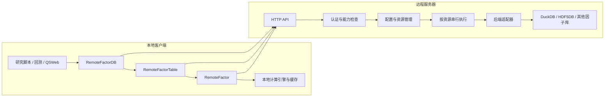

# 远程因子库服务设计方案

日期：2026-10-28。状态：第一版已实现，实施记录见文末。

本文保留设计基线，实施记录说明实际交付及限制。真实使用方法见 [远程因子库](../因子框架/远程因子库.ipynb)，设计中的可选扩展不等同于已经交付。

## 1. 目标与范围

### 1.1 目标

在远程服务器配置多个 QuantStudio/QSExt 因子库，本地发现并选择其中一个，通过 Python 代理对象操作因子库、因子表和因子。现有因子定义、衍生因子计算及回测代码尽量保持原样。

已经确定的职责边界是：**远程负责数据访问，本地负责计算图的构建、调度和执行。**

第一版交付以下能力：

1. 服务端复用 `settings.py` 的 `FACTOR_DATABASES` 配置多个因子库。
2. 客户端查询可访问的因子库及其能力，按逻辑名称选择因子库。
3. 代理因子库、因子表和原子因子的公开数据访问接口。
4. 代理后端支持且服务端允许的写入、结构修改及元信息修改。
5. 本地代理保持 `FactorDB`、`FactorTable`、`Factor` 类型关系，能参与本地计算图和回测。
6. 支持直接读取、本地引擎读取、本地缓存和 Windows 多进程使用。
7. 服务独立部署，QSWeb、研究脚本和其他使用 QuantStudio 的程序均可作为客户端。

### 1.2 执行边界

| 操作 | 执行位置 | 说明 |
| --- | --- | --- |
| 真实因子库创建、连接与关闭 | 服务端 | 客户端不需要安装相应数据库驱动或访问远程文件 |
| 表结构、元信息、ID 和时点查询 | 服务端 | 保留后端原生行为 |
| 数据筛选、复权、财报时点处理、窄表整理 | 服务端 | 属于原有数据源读取语义 |
| `getFactor()` 的原生名称与参数校验 | 服务端 | 支持后端特有的因子命名规则 |
| 标准 `Panel`、`DataFrame` 等结果恢复 | 客户端 | 恢复数据类型和轴，不重新实现后端整理逻辑 |
| 衍生因子构图、算子执行、滚动计算、截面计算 | 本地 | 不向服务端提交计算图 |
| 回测、组合分析、引擎调度 | 本地 | 沿用现有框架 |
| 本地因子缓存及计算结果缓存 | 本地 | 与远程数据版本约定配合 |
| 数据写入、表和因子结构修改 | 服务端 | 受能力及权限限制 |

后端自身提供的查询表达式属于数据源能力，例如 QLib 的字段表达式；它不等于上传并执行 QuantStudio 计算图。此类能力按后端适配器显式声明。

### 1.3 第一版不做的能力

- 远程计算图、远程回测、远程算子执行和任意 Python 函数上传。
- 任意 SQL、`eval`、`exec` 或 Python 对象反射调用接口。
- 远程数据库连接、游标、锁、文件句柄的透明传输。
- 多个因子库之间的分布式事务，以及多次独立调用之间的交互式事务。
- 自动分布式调度、集群、高可用和自动扩容。
- 对所有第三方因子库作未经测试的完整兼容承诺。
- 把 QSWeb 的用户、注册中心、已发布计算服务或业务数据库作为启动依赖。

## 2. 现有实现与可复用基础

### 2.1 代码依据

| 现有模块 | 与本方案的关系 |
| --- | --- |
| [RuntimeConfig/config.py](../../QSExt/RuntimeConfig/config.py) | `DBDef`、`DBPool`、`RuntimeSettings`，提供配置转换、类路径解析和连接管理基础 |
| [DuckDB.py](../../QSExt/Factor/DuckDB.py) | 典型可写后端；同时包含原生表、Parquet 视图和持久化元信息 |
| [QLibDB.py](../../QSExt/Factor/QLibDB.py) | `getFactor()` 支持表达式，说明不能在客户端统一按名称列表校验 |
| [FactorDB.py](../../../QuantStudio/QuantStudio/Factor/FactorDB.py) | 定义因子库及可写因子库公共接口 |
| [FactorTable.py](../../../QuantStudio/QuantStudio/Factor/FactorTable.py) | 定义表读取、索引、元信息、筛选及引擎准备流程 |
| [Factor.py](../../../QuantStudio/QuantStudio/Factor/Factor.py) | 定义因子读取、依赖关系、缓存和本地算子构图 |
| [Core/Identity.py](../../../QuantStudio/QuantStudio/Core/Identity.py) | 区分节点语义身份、请求和数据版本 |
| [QSWeb 配置示例](../../../QSWeb/docker-config/settings.py) | 展示 `FACTOR_DATABASES` 的既有使用方式 |
| [QSWeb factor_service.py](../../../QSWeb/backend/app/services/factor_service.py) | 因子库连接和浏览经验；预览接口不能直接作为完整代理协议 |

### 2.2 已确认的实现约束

1. `DBDef` 接受逻辑名称、类路径、角色、参数和配置文件；`RuntimeSettings` 已负责把字典中的 `class` 转为 `class_path`。
2. `DBPool` 当前是实例及连接状态管理器，不是线程安全连接池。可以复用对象工厂，但不能将一个池中的对象直接交给多个线程并发调用。
3. `DuckDB` 尚未在 `RuntimeConfig` 的内置短名映射中注册。第一版使用完整类路径，避免为服务额外维护另一张短名映射表。
4. 因子库公共基类没有覆盖所有后端扩展方法；某些基类方法仅抛出 `NotImplementedError`。能力发现不能只依赖 `hasattr()` 或继承关系。
5. `Factor.readData()` 的直接读取路径与计算上下文路径不同。带缓存的引擎还会调用原始数据准备和标准化接口。
6. 原生因子表的原始数据不具有统一结构，可能是不同结构的 `DataFrame` 或字典。远程协议应传输标准结果，而非暴露这些内部格式。
7. 现有 `Panel` 是项目自定义数据对象，不是可以直接交给 JSON 或 Arrow 的通用三维类型。
8. QSWeb 已有预览裁剪和独立业务 API 边界。通用代理必须保留完整读取语义，不复用预览裁剪响应。

## 3. 总体架构与部署



### 3.1 第一版部署形态

- 一个独立服务进程，一个 HTTP worker。
- 每个后端资源绑定一个专用执行线程，实例化、连接、读写和关闭均在该线程执行。
- 同一资源的操作串行执行，不同独立资源可以并行。
- HTTP 层通过有界队列向执行线程提交任务，不在事件循环中执行阻塞数据库调用。
- 首版不启动通用进程池，也不通过多个 HTTP worker 复制后端连接。

专用线程可以满足常见的连接线程归属要求，并减少后端元信息缓存的并发修改。它不能隔离所有后端的进程级全局状态：对存在此类限制的库，适配器必须声明全局互斥，或暂不提供第一版正式支持。

### 3.2 资源归属

配置中的逻辑库名称是公开选择入口，实际连接由资源管理器持有。

同一个 DuckDB 文件配置成多个别名时，不能为每个别名创建独立写入所有者。第一版启动时检测已支持文件后端的路径重复；未显式声明共享归属的重复配置报错。无法可靠识别的第三方后端，由部署者保证资源没有冲突。

客户端 `connect()` 进行协议协商、选择库并校验权限；可以按需触发服务端连接。`disconnect()` 释放客户端 HTTP 资源，不关闭其他客户端仍在使用的真实因子库。

服务端真实连接在空闲回收或服务退出时统一关闭。首版可以仅在退出时回收，以减少连接生命周期分支。

## 4. 配置设计

### 4.1 服务端数据库配置

沿用 `FACTOR_DATABASES`，业务数据路径通过环境变量或部署配置提供：

```python
import os
from pathlib import Path

data_root = Path(os.environ["QS_FACTOR_DATA_ROOT"])

FACTOR_DATABASES = [
    {
        "name": "market",
        "class": "QSExt.Factor.DuckDB.DuckDB",
        "role": "source",
        "args": {"ParquetDir": str(data_root / "market")},
    },
    {
        "name": "research",
        "class": "HDF5DB",
        "role": "target",
        "args": {"MainDir": str(data_root / "research")},
    },
]
```

`config_file` 沿用 `DBDef` 的字段，配置文件在服务器解析。数据库凭据只存在于服务端部署配置，不作为目录响应的一部分。

配置必须校验逻辑名称唯一、名称非空、类路径合法、导出的库在定义中存在、资源路径不冲突。某个库连接失败不应令整个目录不可访问；该库返回不可用状态，其余库仍可使用。

### 4.2 服务访问配置

新增独立的 `FACTOR_SERVICE` 配置，不向 `DBDef` 中塞入权限字段，避免被现有配置转换丢弃：

```python
FACTOR_SERVICE = {
    "ServiceID": "research-factor-service",
    "Host": "127.0.0.1",
    "Port": 8765,
    "Auth": {
        "TokenEnv": "QS_FACTOR_SERVICE_TOKEN",
    },
    "Databases": {
        "market": {
            "ResourceID": "market-primary",
            "Access": "read",
        },
        "research": {
            "ResourceID": "research-primary",
            "Access": "read_write",
        },
    },
    "Limits": {
        "MaxRequestBytes": 8 * 1024 * 1024,
        "MaxResponseBytes": 256 * 1024 * 1024,
        "MaxCells": 5_000_000,
        "MaxQueueSize": 64,
        "QueueTimeoutSeconds": 30,
    },
}
```

这些数值是初始配置示例，实施时通过基准测试确定默认值。`FACTOR_SERVICE.Databases` 是显式导出清单；未列出的库不对外提供。

`ServiceID` 和 `ResourceID` 是稳定公开身份，不随服务重启变化。修改某个逻辑库指向的真实数据源时，应更新其资源身份或配置修订，防止本地缓存误用。

第一版采用一个服务令牌和按库访问模式，不预先引入多用户系统。令牌从环境读取，不写入示例，不以 `role=source/target/proxy` 推导权限。对外部署使用 HTTPS，可由反向代理终止 TLS；客户端默认校验证书。

### 4.3 配置加载

1. 服务入口显式指定 `settings.py` 路径。
2. 使用现有 `RuntimeSettings` 加载 `FACTOR_DATABASES`。
3. 使用服务自身的 Pydantic 模型加载 `FACTOR_SERVICE`；它不是现有 `RuntimeSettings` 的已知字段，不能期待自动保留。
4. 保留现有配置继承与覆盖约定；启动日志记录最终配置来源及公开资源标识，不记录凭据。
5. 第一版配置变更通过重启生效，不实现在线修改连接定义。

### 4.4 客户端配置

客户端代理是普通因子库类，可以进入已有的 `DBPool`：

```python
FACTOR_DATABASES = [
    {
        "name": "remote_market",
        "class": "QSExt.Factor.RemoteDB.RemoteFactorDB",
        "role": "source",
        "args": {
            "ServerURL": "https://factor.example.com",
            "Database": "market",
            "TokenEnv": "QS_FACTOR_CLIENT_TOKEN",
            "TimeoutSeconds": 120,
        },
    },
]
```

`ServerURL`、`Database`、认证来源、连接超时和读取超时由代理参数管理。认证令牌在建立传输连接时解析，不把令牌值存进 `Args`、`QSID`、对象序列化结果或日志。

客户端仅依赖 QuantStudio、QSExt 客户端组件和传输依赖，不依赖 DuckDB、数据库驱动或服务器上的路径。

## 5. 客户端对象模型与兼容契约

### 5.1 类与职责

| 类 | 基类 | 职责 |
| --- | --- | --- |
| `FactorDBServiceClient` | 普通客户端对象 | 服务信息、库目录、能力发现和共享 HTTP 传输 |
| `RemoteFactorDB` | `WritableFactorDB` | 库选择、表访问及受能力限制的写接口 |
| `RemoteFactorTable` | `FactorTable` | 表描述、标准读取、筛选和远程因子创建 |
| `RemoteFactor` | `Factor` | 本地叶子因子、远程读取、本地引擎及标准数据缓存适配 |

`RemoteFactorDB` 继承可写基类只是为了提供统一方法签名，不表示每个远程库都可写。每次写调用由服务端执行能力与权限检查；客户端提前检查仅用于及时报错。

### 5.2 预期使用方式

```python
from QSExt.Factor.RemoteDB import FactorDBServiceClient, RemoteFactorDB

client = FactorDBServiceClient(
    server_url="https://factor.example.com",
    token_env="QS_FACTOR_CLIENT_TOKEN",
)
databases = client.listDatabases()

fdb = RemoteFactorDB(args={
    "ServerURL": "https://factor.example.com",
    "Database": "market",
    "TokenEnv": "QS_FACTOR_CLIENT_TOKEN",
}).connect()

ft = fdb.getTable("daily", args={"LookBack": 0})
close = ft.getFactor("close")
open_ = ft.getFactor("open")

prices = ft.readData(factor_names=["close", "open"], ids=IDs, dts=DTs)
returns = close / open_ - 1
result = returns.readData(ids=IDs, dts=DTs)

fdb.disconnect()
client.close()
```

以上表名、因子名及参数仅为示例，以所选后端真实接口为准。`returns` 的构图与计算全部发生在本地。

### 5.3 参数与对象身份

远程对象使用可重建描述，不要求服务端长期保存 Python 对象句柄：

```text
DatabaseDescriptor = ServiceID + ResourceID + ConfigRevision
TableDescriptor    = DatabaseDescriptor + TableName + ResolvedTableArgs
FactorDescriptor   = TableDescriptor + FactorName + ResolvedFactorArgs
ReadRequest        = Descriptor + IDs + DTs + SectionIDs + DTRuler + ReadOptions
```

区分两类参数：

- 本地执行参数：本地缓存开关、本地并行策略等，交给本地框架处理。
- 后端语义参数：表类型、时点字段、回溯、财报处理等，通过白名单与类型编码传给服务端。

服务端返回实际生效的后端参数；客户端据此创建冻结描述，并用于请求、身份和缓存。不得忽略不认识的参数，也不得把 `SourceFDB`、日志对象、线程执行器等本地资源发送到服务器。

后端参数在代理 `Args` 中使用明确的嵌套字段保存，不动态重建任意远程 Pydantic 类。通过 `getTable(args=...)`、`getFactor(args=...)` 和代理覆盖后的 `.new(args=...)` 修改参数：`.new()` 重新解析参数、生成新描述和新身份，不改变原对象。

第一版不承诺 `ft.Args.LookBack` 等原生后端专有属性在代理中拥有相同的扁平布局，也不代理对后端 `Args` 的原地修改。提供参数描述查询，说明每个参数属于本地还是远端。此差异需要进入使用文档。

### 5.4 三种身份

1. `QSID`：稳定的代理语义身份，包括服务、资源、表、因子及影响结果的参数。
2. `InstanceID`：本地节点实例身份，继续由框架生成。
3. 数据版本：用于结果缓存有效性，不替代 `QSID`。

HTTP 连接、随机请求号、令牌值、服务进程启动标识不参与语义 `QSID`。服务端内部因子 `QSID` 可以作为诊断信息返回，但不要求与本地代理 `QSID` 相同。

逻辑名称改指其他 `ResourceID` 时，已创建的对象不能静默迁移；返回资源变化错误，要求重新连接和建表。服务重启但资源身份不变时，允许按描述重建。

## 6. 操作目录与能力发现

### 6.1 公共代理操作

| 对象 | 操作 | 返回或行为 |
| --- | --- | --- |
| 服务 | `listDatabases()` | 公开名称、状态、资源身份、访问模式 |
| 因子库 | `Name`、`TableNames`、`getTable()`、`__getitem__` | 返回值或本地表代理 |
| 因子表 | `getMetaData()`、`FactorNames`、`getFactorMetaData()` | 标量、Series、DataFrame |
| 因子表 | `getID()`、`getDateTime()` | 原生顺序及类型的列表 |
| 因子表 | `getIDMask()`、`getFilteredID()` | 在服务端按原生语义筛选 |
| 因子表 | `readData()` | 恢复为 `Panel` |
| 因子表 | `getFactor()`、`__getitem__` | 因子创建委托服务端，切片在本地恢复结果后执行 |
| 因子 | `getMetaData()`、`getID()`、`getDateTime()` | 委托对应真实原子因子或适配器 |
| 因子 | `readData()`、`__getitem__` | 远程取数，恢复 DataFrame 或本地切片结果 |
| 因子 | 算术、比较、框架算子组合 | 沿用本地 Factor 构图，完全在本地执行 |
| 可写因子库 | `writeData()` | 上传标准 Panel，交给原生后端 |
| 可写因子库 | `renameTable()`、`deleteTable()` | 受权限控制的原生调用 |
| 可写因子库 | `renameFactor()`、`deleteFactor()` | 受权限控制的原生调用 |
| 可写因子库 | `setTableMetaData()`、`setFactorMetaData()` | 保留原生参数和空值语义 |

因子的本地 `Meta` 覆盖继续保持本地行为；修改后端持久化元信息仍通过因子库的元信息写接口进行，不把两者混在一起。

### 6.2 后端扩展

以下方法并非所有因子库都具有，按适配器分别注册：

- `createTable()`、`addFactor()`、`deleteData()`。
- `deleteTableMetaData()`、`deleteFactorMetaData()`。
- JYDB 的 `getTradeDay()`、`getStockID()` 等数据源查询。
- 其他经验证的公开数据访问接口。

扩展接口具有固定名称、参数 Schema、返回编码及读写分类。客户端可以提供显式方法或 `callExtension()`；为接入现有配置中的方法名，可对已发现的扩展提供受限属性绑定。不能用通用 `getattr()` 暴露任意公开方法。

能力清单至少包含：操作名称、目标类型、是否修改状态、适用的表、参数描述、结果类型及协议版本。最终允许执行的集合是后端已实现能力、适配器允许能力和服务访问策略三者的交集。

DuckDB 原生表与 Parquet 视图能力不同，应支持表级能力查询。对不支持的操作返回明确错误，不能伪装成功。

### 6.3 语义保真要求

- 保留 `None`、空列表和未传参数之间的区别，不擅自替换为全部对象。
- 保留 ID、时点、因子顺序、中文名称和空结果结构。
- `if_exists`、`data_type` 及后端扩展参数原样校验，不重新解释其含义。
- 后端读操作的缺失值补齐、回溯和对齐规则在服务器执行一次。
- 原生错误转换为结构化远程错误，但保留可辨识的原因。
- 不默认裁剪证券、日期或因子，不做隐藏分页。

## 7. HTTP 协议

### 7.1 技术选择

第一版使用 FastAPI/ASGI 提供 HTTP 接口，同步 Python 客户端使用 HTTPX。控制参数使用带类型标记的 JSON，表格数据使用 Arrow IPC。无需 WebSocket、gRPC 或 Arrow Flight。

客户端同步接口与现有框架一致，服务端异步仅用于网络和队列等待。数据库操作仍由专用线程执行。

### 7.2 接口清单

统一前缀为 `/api/factor/v1`：

| 方法与路径 | 职责 |
| --- | --- |
| `GET /health` | 最小存活检查，不泄露配置 |
| `GET /info` | 协议版本、服务身份、启动标识、支持的编码及限制 |
| `GET /databases` | 当前调用者可见的库目录 |
| `GET /databases/{database}/capabilities` | 库级能力与资源修订 |
| `POST /databases/{database}/describe` | 库、表、因子描述与参数规范化 |
| `POST /databases/{database}/invoke` | 白名单操作，参数与结果为结构化 JSON |
| `POST /databases/{database}/read` | 标准表或原子因子读取，返回 Arrow IPC |
| `POST /databases/{database}/read-batch` | 一次传入多个原子读取描述，返回带映射的标准结果 |
| `POST /databases/{database}/write` | 元信息字段与 Arrow 数据组成的上传请求 |
| `GET /operations/{operation_id}` | 查询本进程内已登记写操作的状态 |

表名、因子名和参数放在请求体中，避免中文名称、斜杠和引号的路径编码问题。库名作为 URL 路径段必须正确转义，并在服务端精确匹配导出清单。

### 7.3 调用请求示例

```json
{
  "request_id": "客户端生成的请求标识",
  "resource_id": "market-primary",
  "config_revision": "公开配置修订",
  "target": {
    "kind": "table",
    "table_name": "daily",
    "table_args": {"LookBack": 0}
  },
  "operation": "getDateTime",
  "kwargs": {
    "start_dt": {"$type": "datetime", "value": "2026-01-01T00:00:00"},
    "end_dt": {"$type": "datetime", "value": "2026-01-31T00:00:00"}
  }
}
```

协议显式区分未传字段和传入 `null`。参数模型拒绝额外控制字段；后端 `kwargs` 由适配器 Schema 校验，未知参数不静默丢弃。

### 7.4 批量读取

`read-batch` 传递读取规格列表，不传递 Node、依赖边、算子、函数或计算图。

每个读取规格有稳定的 `read_spec_id`。服务器只对适配器声明可以安全合并的请求调用批量表读取；有不同因子参数、不同日期语义或不同截面要求时分别调用。不能为了合并而改变原生因子的含义。

第一版批量结果可使用一个清单和若干 Arrow 段组成的有界封装，包含段长度、校验值和 `read_spec_id`。同一套封装供单次读取使用。HTTP 成功状态下仍需验证所有段完整；中断或校验失败后整个调用失败，不向计算引擎返回部分结果。

### 7.5 错误模型

错误响应包含：`code`、中文 `message`、`request_id`、目标描述摘要、`retryable`、`operation_id` 和写入结果状态。服务端堆栈写入日志，客户端响应不包含密码、完整连接串或任意服务器文件路径。

| 错误类别 | HTTP 状态 | 客户端处理 |
| --- | --- | --- |
| 参数或编码不支持 | 400 / 422 | 修正参数，不重试 |
| 未认证 / 无权限 | 401 / 403 | 更新认证或访问配置 |
| 库、表、因子不存在 | 404 | 刷新目录或修正名称 |
| 资源修订变化 / 状态冲突 | 409 | 重建对象，写操作先确认结果 |
| 数据体积超过限制 | 413 | 显式缩小请求，不自动拆分语义读取 |
| 能力不支持 | 422 | 向上层报告明确的能力错误 |
| 队列已满 | 429 | 仅只读请求允许有限退避重试 |
| 后端不可用 | 503 | 只读请求按策略重试 |
| 超时 / 未分类后端错误 | 504 / 500 | 保留诊断，写操作进入结果确认流程 |

代理异常统一继承框架错误类型，并附加结构化字段。无需反序列化服务端任意 Python 异常类。

## 8. 数据编码与传输

### 8.1 控制值编码

使用显式类型标记支持：日期、日期时间、时区时间、NumPy 标量、元组、非有限浮点值，以及受支持的字典和列表。对用户本身包含保留标记键的字典进行转义，避免与协议类型混淆。

日期与日期时间保持类型区别；无时区时间不擅自解释为 UTC，有时区时间保留时区信息或明确规范化规则。字典键不通过 `str()` 随意转换。

不使用 `pickle`、`dill` 或可调用对象的自动兜底。第一版仅支持列出的数据类型，不支持的值报告所在字段及类型。

### 8.2 标准数据封装

封装由对象清单和 Arrow IPC 数据段组成：

| 字段 | 含义 |
| --- | --- |
| `object_kind` | Panel、DataFrame、Series 或标量 |
| `axes` | 各轴标签、名称、类型、顺序及长度 |
| `fields` | 各因子或列的类型和编码策略 |
| `segments` | 数据段映射、字节长度、校验值 |
| `read_spec_id` | 对应的读取规格 |
| `resource_version` | 可选数据版本及其可信度 |
| `read_at` | 本次读取完成时间，不等同于数据版本 |

Panel 按因子分别编码二维数据，清单单独保存 `items`、`major_axis` 和 `minor_axis`。不能仅依赖 `Panel.to_frame()`，因为它可能丢失全缺失位置或空轴信息。

传输列使用内部编号关联标签，避免中文、重复标签或特殊名称成为协议字段冲突。重复轴是否支持以本地对象为准；本地可表达的结构应能往返恢复，本地不支持的结构在入口明确拒绝。

### 8.3 类型保真

首版必须覆盖数值、布尔、字符串、日期时间、空值、空轴和标准元信息的往返恢复。`NaN`、`None`、`NaT`、`pd.NA` 是否可区分，按字段 dtype 和显式编码规则处理，不能统一转成 JSON `null` 后声称无损。

对 `object` 列采用声明式策略：

- 全为可统一表示的标量时使用确定的 Arrow 类型，并保存恢复类型。
- 列表、元组、字典及混合基础标量使用带类型标记的受限单元格编码。
- 自定义类、函数、文件句柄等拒绝传输。

Series 和 DataFrame 保留轴名称、索引类型、dtype，以及约定范围内的扩展类型。无法恢复的类型在能力中标记不支持，而不是转成字符串。

### 8.4 大结果与内存

首版采用有大小限制的同步调用，可以流式发送 Arrow 批次，但客户端在结果完整后才交给现有同步 API。

为保持行为一致，不在客户端自动按 ID 或时间拆分请求：财报、回溯及截面语义可能因此改变。超过限制时明确拒绝；调用者可以显式缩小范围，或后续通过具有一致性契约的结果下载机制扩展。

限制检查同时覆盖上传体积、预估单元格数、实际结果字节数及队列长度。对象单元格的实际大小不能只按单元格数估算。编码超限与流中断不得产出可使用的半份结果。

## 9. 本地计算引擎与缓存适配

### 9.1 采用标准结果适配

服务端调用真实因子表或原子因子的原生读取能力，完成后端数据整理，返回标准结果。客户端不远程调用 `__QS_prepareRawData__()`，也不接收后端原始数据结构。

`RemoteFactor` 保留 Factor 类型和本地运算符行为，但覆盖直接读取、标准数据缓存准备及叶子节点的结果获取路径。`RemoteFactorTable` 覆盖原生准备逻辑，避免继承逻辑误将标准结果当成后端原始数据缓存。

### 9.2 直接读取路径

1. `RemoteFactorTable.readData()` 构造表读取请求，在服务端执行一次标准读取，恢复 Panel。
2. `RemoteFactor.readData()` 在没有本地计算上下文时构造原子因子请求，恢复 DataFrame。
3. 在已有本地计算上下文中，`RemoteFactor.readData()` 继续进入本地引擎，不能绕过本地上下文、截面或缓存语义。
4. 因子算术和 `fo.*` 沿用本地构图。服务端从未收到衍生因子描述。

### 9.3 生命周期适配

| 阶段 | 代理职责 |
| --- | --- |
| `init_compute` | 沿用 Factor 的日期范围、截面、节点状态校验；登记读取规格，不执行耗时网络读取 |
| `prepare_compute` | 根据本地引擎已展开的日期和截面需求，批量预取标准原子因子数据并写入本地缓存 |
| `forward_compute` | 保留叶子因子的本地上下文传递，不遍历服务端节点 |
| `backward_compute` | 读取本地标准缓存；无缓存或缺片时按完整规格补读，返回当前节点要求的数据 |
| `merge_result` | 沿用本地合并契约，确保 ID/日期顺序符合本地引擎约定 |

建议由 `RemoteFactor.init_compute()` 在完成父类本地状态登记后，注册远程读取准备项；以代表因子节点的 `InstanceID` 执行 `prepare_compute()`。远程表节点不再登记原生后端的原始数据预取项，避免双重准备。

读取准备项按兼容的表描述、读取选项、截面及版本策略分组，内部保存每个完整因子描述。**不能仅以因子名称作缓存键**：同表同名、不同参数的两个因子必须区分。

`prepare_compute()` 的结果通过本地缓存接口保存，不在准备阶段修改运行上下文的全局结构。没有 `DataCache` 时可以直接在结果获取阶段读取，首版不承诺这一模式也能实现跨因子预取合并。

### 9.4 回溯、截面与参数

- 本地时间算子负责展开上游原子因子的所需日期，代理使用展开后的 `DTRuler` 和节点状态读取，不能只传最终输出日期。
- `SectionIDs` 与输出 `IDs` 分开传递；截面相关需求不能因多进程拆分丢失。
- 同一因子在多个上游使用不同日期或截面时，按框架既有状态规则合并或区分请求。
- 后端固有回溯、公告日等参数在服务端执行，客户端不得再次应用。
- 服务端明确校验哪些选项可以透传给原生表，不能把本地框架控制参数作为后端关键字随意传入。

### 9.5 标准因子缓存

覆盖 `RemoteFactor._prepareCacheData()` 及必要的 `backward_compute()` 路径，绕开父类对后端原始数据字段的依赖；继续使用本地框架已有的标准因子缓存和日期覆盖记录。

实现时验证 `makeFactorRunningKey()`、缓存的 PID 分片和 `getDTRange()` 实际签名，不以新的 HTTP 请求缓存替代框架缓存。优先仅在 QSExt 子类中完成；如证明确需修改 QuantStudio 核心，变更应限定为通用数据源扩展点，并单独说明依据和回归范围。

首个原型必须证明三条路径一致：直接原子读取、无缓存的本地衍生计算、带缓存的本地衍生计算。此项通过后再实现全部写接口。

### 9.6 多进程

代理对象可在本地引擎中序列化，但序列化内容仅包含配置引用、公开身份和可重建描述。

- HTTPX 客户端、socket、锁和线程局部状态不进入序列化结果。
- 子进程按 PID 惰性创建自己的 HTTP 客户端，从本机认证来源重新读取令牌。
- 重新建连必须校验服务与资源身份。
- 缓存分片沿用本地引擎，不能将主进程内存中的预取结果视为自动可供子进程读取。
- 对象恢复和描述重建不依赖服务端随机会话句柄。

## 10. 数据版本与一致性

### 10.1 版本分类

| 版本 | 作用 | 不能代表的内容 |
| --- | --- | --- |
| 协议主版本 | 客户端与服务端契约 | 数据快照 |
| 配置修订 | 资源绑定和配置语义变化 | 底层数据更新 |
| 元信息修订 | 经本服务进行的结构和元信息变化 | 外部工具修改 |
| 数据版本 | 后端或适配器提供的可验证数据状态 | 不可验证的跨库一致快照 |
| 服务启动标识 | 进程内操作状态和诊断 | 稳定数据身份 |

第一版默认读取来源当前数据，不承诺跨多个请求的事务快照。`read_at` 和本服务自行递增的计数不能伪装成后端真实快照。

### 10.2 本地缓存规则

1. 没有可信数据版本时，默认只在本地当前运行范围复用；不承诺跨运行持久缓存有效。
2. 后端提供可信版本或部署者提供明确不可变数据版本时，才允许按该版本跨运行复用。
3. 未提供版本时，客户端在一次本地运行开始时刷新目录和已使用资源的修订。
4. 服务内写入成功后失效相关元信息及数据缓存；同一客户端立即刷新，其他客户端在运行边界或刷新间隔更新。
5. 长时间本地计算中若检测到资源配置变化，停止并报告；底层数据的外部写入若无法检测，则不能承诺发现或冻结。

批量读取尽量在同一资源队列任务中完成，但是否有事务快照由后端决定，不能因为一个 HTTP 请求就宣称所有读取原子一致。

## 11. 写入、权限与失败语义

### 11.1 写入分派

写入采用与读取相同的资源执行队列，避免查询结果和后端内部元信息被同一服务的并发调用交叉修改。

在真实执行前完成：认证、能力检查、描述校验、参数校验、上传大小检查和数据解码。传输失败或解码失败不应开始后端写入。

`writeData()` 传入服务器恢复后的独立 Panel，避免后端就地修改调用者对象。结构和元信息操作继续调用原生公开方法，不能绕过原生元信息维护。

### 11.2 原子性边界

单次操作的原子性继承后端本身的保证。服务层不把“顺序执行”包装成“事务执行”。例如某些后端写入先删除再插入，失败时可能部分生效，接口必须允许报告部分生效或结果未知。

不承诺一次跨库复制原子完成，不提供远程事务连接或 `begin/commit` 会话。

### 11.3 重试与状态查询

读取请求可以有限重试，但每次可能看到更新后的数据；需要版本一致时必须验证返回版本。

写入请求不自动重试。每次写调用携带唯一 `operation_id`、服务启动标识和有效截止时间。服务在分派到执行线程前登记操作状态：

```text
QUEUED → RUNNING → SUCCEEDED
                 → FAILED（附后端确认的结果状态）
                 → UNKNOWN（无法确认是否完整生效）
```

同一进程、有效期内的重复标识返回已登记状态，不再次执行；相同标识但参数摘要不同返回冲突。超过有效期拒绝重放，不能因为登记缓存已清理就再次执行。

第一版操作登记只保证当前服务进程内去重。服务重启后旧启动标识失效，旧操作查询返回结果未知，不重新执行；不宣称“恰好一次”。如果以后要求跨重启恢复，需要独立持久操作记录及与后端写入原子提交的进一步设计。

### 11.4 超时和取消

- 排队超时且尚未分派时，保证未执行。
- 执行开始后的客户端超时或断开，不代表数据库已取消或回滚。
- 后端不能可靠取消时，任务继续占用资源执行线程；不得提前放行后续任务并发使用同一连接。
- 客户端可以查询 `operation_id`；状态未知时由调用方核对后端数据，再决定后续操作。
- 取消读取也只有在后端确认取消后才能释放资源所有权。

## 12. 服务端后端适配

### 12.1 适配器职责

服务框架不按后端类型写大段条件分支。适配器只处理公共接口差异、能力登记、必要的参数转换和资源互斥要求，不复制数据库读取算法。

通用适配器覆盖标准因子库接口；具体后端按声明补充能力。服务器只从管理员配置导入真实类，客户端请求不能指定任意类路径或服务器配置文件。

### 12.2 首版验证后端

| 后端 | 第一版要求 |
| --- | --- |
| DuckDB 原生表 | 读取、元信息、数据写入与已支持的结构维护 |
| DuckDB Parquet 视图 | 读取、原生允许的元信息操作；拒绝视图数据写入和不支持的结构操作 |
| HDF5DB | 读取、数据写入和原生支持的元信息维护 |
| 只读测试后端 | 验证只读能力、空结果、错误和类型边界 |
| JYDB 等需外部环境的后端 | 可配置接入；通过独立集成测试后再标记为已验证支持 |

服务在数据文件所在机器运行，因此 DuckDB 持久视图继续使用服务器本地路径，客户端不再承担共享目录路径转换。

服务不能解决其他进程同时以不兼容方式访问同一个 DuckDB 文件的问题。部署时由本服务持有写连接，外部更新统一经服务写入，或使用后端明确支持的独立发布方式。

## 13. 日志、限制与部署运维

- 使用框架日志，记录请求号、操作号、公开资源标识、操作名、排队耗时、执行耗时、编码耗时和传输大小。
- 写日志记录参数摘要和结果状态；不默认记录完整数据、认证头、数据库密码或用户隐私数据。
- 健康检查区分服务存活和数据库可用，不因一个库暂时失败让所有请求都被摘除。
- 服务关闭先停止接收新任务，等待有界排空，再在各资源线程关闭数据库；未完成写操作明确记录未知状态。
- CPU 密集编码与后端调用不能无限占用网络事件循环；编码执行方式和队列大小通过基准测试确定。
- 第一版不配置多 HTTP worker。未来扩展必须先把资源所有权从 API 进程中独立出来。
- 服务无需前端、Neo4j、QSWeb 数据库或外部消息队列。

## 14. 工程组织与依赖

建议新增如下文件，名称在实施时可按仓库实际风格小幅调整：

```text
QSExt/
├── Factor/
│   └── RemoteDB.py                    # 对外代理类及公开导入
└── FactorService/
    ├── __init__.py
    ├── config.py                     # 服务配置与导出策略
    ├── protocol.py                   # 描述、能力、请求、错误和版本
    ├── codec.py                      # 控制值与标准数据编码
    ├── client.py                     # HTTP 客户端及连接重建
    ├── proxy.py                      # 表、因子与引擎适配
    ├── registry.py                   # 资源工厂和生命周期
    ├── executor.py                   # 专用线程与有界队列
    ├── adapters.py                   # 标准及后端扩展能力
    └── server.py                     # HTTP 应用与入口
scripts/
└── run_factor_service.py             # 功能性启动脚本
examples/FactorService/
└── settings.py                       # 无凭据的服务端配置示例
tests/
├── test_FactorService_Config.py
├── test_FactorService_Codec.py
├── test_FactorService_Protocol.py
├── test_FactorService_Read.py
├── test_FactorService_Write.py
├── test_FactorService_Engine.py
└── test_FactorService_Multiprocess.py
docs/plans/
└── 远程因子库服务设计方案.md
```

优先在 QSExt 内实现，避免修改已有各因子库。`RuntimeConfig` 使用完整代理类路径即可，无需修改其工厂逻辑。若 `QSExt/Factor/api.py` 存在且约定用于公开导出，再按现有风格注册。

客户端可选依赖为 HTTPX、PyArrow；服务端在客户端依赖之外增加 FastAPI、Uvicorn。应提供独立可选依赖组，不能因安装 QSExt 就强制安装所有服务端或数据库后端依赖。具体版本范围在实施时按兼容测试确定。

功能脚本位于 `scripts/`，开头以中文 Google 风格模块文档字符串说明实现逻辑、运行条件、命令与参数。模块文档放在 `docs/`；方案稳定并落地后再补充真实 API 使用文档，不将本方案中的拟议示例当作已实现接口生成 Skill。

拟议启动方式：

```powershell
python scripts/run_factor_service.py --settings path/to/settings.py
```

## 15. 实施步骤与完成标准

### 阶段一：协议、配置与生命周期原型

交付配置模型、资源身份、能力描述、编码原型，以及最小客户端和服务端。先用测试后端贯通库目录、标准读取和本地 RemoteFactor。

完成标准：

- 能按 `FACTOR_DATABASES` 配置多个库，显式导出其中一部分。
- 直接读取、无缓存本地衍生计算、带缓存本地衍生计算结果一致。
- 证明本地引擎生命周期可以通过 QSExt 子类适配；若不能，明确最小核心扩展点再进入下一阶段。
- 证明服务端没有执行计算图或加载客户端函数。

### 阶段二：完整读取与本地引擎接入

实现公开读接口、参数规范化、元信息、ID/时点查询、标准编码、读取批次、本地缓存和多进程连接重建。

完成标准：DuckDB 与 HDF5DB 的相同查询在本地和远程结果一致；滚动、截面和回测路径通过；没有静默参数丢失或数据裁剪。

### 阶段三：可写接口与失败处理

实现上传、结构与元信息操作、能力控制、资源串行队列、操作登记和超时状态。

完成标准：后端支持的写操作行为与本地一致；Parquet 视图和只读库明确拒绝不支持操作；模拟响应丢失不会自动重复写入；部分失败不被报告为完整回滚。

### 阶段四：部署与文档

完成启动脚本、配置示例、可选依赖、协议协商、日志、真实 HTTP 集成验证及资源基准测试。

完成标准：独立部署可复现，客户端仅改因子库配置即可读取和计算；QSWeb 可通过现有配置工厂创建代理，若其当前连接管理白名单不能识别完整类路径，则单独列出并实施最小接入改动，不把它隐含在通用服务中。

## 16. 测试与验收矩阵

测试采用 `unittest.TestCase`，测试脚本全部放在项目 `tests/`。使用确定性日期、证券和数据，不依赖个人配置或真实凭据。

| 类别 | 必测场景 | 验收依据 |
| --- | --- | --- |
| 配置 | 多库、名称重复、类路径、导出清单、配置文件、权限独立于 role | 正确加载或明确报错 |
| 目录 | 部分库连接失败、只返回公开字段、多个资源选择 | 其他库可用且凭据不泄露 |
| 表及因子 | 元信息、参数、特殊名称、原生 getFactor 校验、`.new()` | 与后端行为一致 |
| 读取 | 不同轴顺序、缺失值、空轴、空结果、None 与空列表 | Panel/Frame/Series 结构和值一致 |
| 编码 | dtype、日期/时区、混合 object、特殊浮点、全空字段 | 支持类型准确恢复，未知类型拒绝 |
| 本地算子 | 算术、时间窗口、截面、不同 DTRuler/SectionIDs | 与直接本地后端的计算结果一致 |
| 缓存 | 无缓存、冷缓存、热缓存、参数变化、版本变化 | 不复用错误缓存，命中后减少读取 |
| 批量 | 同表多因子、同名不同参数、不同截面 | 正确合并或分离，无串值 |
| 多进程 | Windows spawn、独立 HTTP 连接、PID 分片 | 无 socket/锁序列化故障 |
| 写入 | update/append/replace、后端实际扩展模式、结构、元信息 | 尊重原生语义并验证最终数据 |
| 权限 | 只读库、表级只读视图、未导出库、未知扩展 | 服务端拒绝且没有状态修改 |
| 并发 | 同库串行、不同库并行、首次连接竞争、别名冲突 | 连接归属和元信息一致 |
| 故障 | 排队超时、执行超时、响应丢失、重复操作号、进程重启 | 不重复写入或伪造成功 |
| 限制 | 大请求、大结果、对象单元格、队列满、流中断 | 明确失败，不返回截断结果 |
| 协议 | 主版本不兼容、资源改绑、服务重启重建 | 明确拒绝或按身份恢复 |
| 运行环境 | 外层进程已有本地计算上下文 | 服务端读取不意外进入图引擎 |

测试分层为编码单测、适配器单测、进程内 HTTP 测试和独立进程真实 HTTP 集成测试。Windows 多进程与网络中断必须由真实进程测试覆盖，不能完全用 mock 代替。

本地对照测试分别调用真实后端和远程代理，对齐后比较轴、dtype、缺失值和数值。浮点使用明确容差，其余精确比较；不能只验证输出形状。

服务端不执行计算图应通过测试明确证明：远程请求中出现算子、函数或计算图字段时拒绝；客户端衍生计算期间的服务端记录只有允许的数据源操作。

验证顺序：定向编码与协议测试 → 代理及后端测试 → 本地引擎与多进程测试 → 仓库相关回归及全量测试。外部数据库集成测试按环境单独执行，报告缺失前提，不能以跳过代替已验证支持。

## 17. 性能验证

性能目标首先是语义正确和资源可控，不在未测量前承诺固定加速比例。

记录本地直接读取和远程读取的总耗时、后端耗时、编码耗时、网络字节数、请求次数、服务端峰值内存及本地峰值内存。

基准场景包含：小范围单因子、多因子日频、分钟数据、混合字符串或对象字段、本地多因子衍生计算、缓存二次读取，以及并发访问多个库。

验收要求：同一准备组的多个兼容原子读取可合并为有限次网络请求；热缓存不反复读取相同标准数据；队列和内存不无限增长。根据测量结果再确定默认体积限制和批次大小，不提前增加复杂结果存储系统。

## 18. 风险、边界与后续扩展

| 风险 | 第一版处理 |
| --- | --- |
| 原生原始数据格式不同 | 协议只传标准结果，客户端覆盖相关缓存路径 |
| 参数布局与本地后端不完全相同 | 保留构造参数语义，明确代理 Args 布局和修改方式 |
| 类型编码过度承诺 | 明确支持范围，未支持类型拒绝而非转字符串 |
| 外部数据更新无法验证 | 当前运行缓存，可信版本缺失时不保证跨运行复用 |
| 第三方后端存在进程全局状态 | 适配器声明全局互斥或暂缓正式支持 |
| 写入失败可能部分生效 | 保留后端保证，返回明确状态，不自动重放 |
| 任意扩展扩大接口边界 | 固定操作注册、参数 Schema 和读写分类 |
| 大结果拖慢所有请求 | 有界队列、结果限制、独立资源执行和性能验证 |

后续可以独立扩展多用户授权、可信快照、结果下载、后端独立进程及更多适配器。远程计算图不属于本方案范围，未来若需要应作为单独能力设计，不改变当前“数据访问远程、计算本地”的默认契约。

## 19. 最终交付检查表

- [x] 多个远程因子库可通过已有配置格式声明并按名称选择。
- [x] 客户端保留因子库、表和因子的公共使用链路。
- [x] 原子数据访问在远程执行，所有衍生计算和回测在本地执行。
- [x] 直接读取、引擎、缓存和 Windows 多进程均有对照测试。
- [x] 数据类型、轴、空值及顺序有明确传输契约。
- [x] 只读与可写能力由服务端真实校验。
- [x] 写入超时、响应丢失和服务重启不会触发自动重复写入。
- [x] 资源身份、数据版本和本地缓存边界明确。
- [x] 独立部署不依赖 QSWeb、注册中心或计算图服务。
- [x] 所有拟议接口在实现文档中与真实接口核对后再发布。

## 20. 参考资料

- [QuantStudio 通则和约定](../../../QuantStudio/docs/通则和约定.ipynb)：对象、参数集、QSID 与 Panel 的既有约定。
- [DuckDB 并发模型](https://duckdb.org/docs/1.5/connect/concurrency)：原生文件的进程读写边界；服务资源所有权需遵守后端限制。
- [FastAPI 部署概念](https://fastapi.tiangolo.com/deployment/concepts/)：多 worker 的进程与内存模型；第一版采用单 HTTP worker。
- [Arrow IPC](https://arrow.apache.org/docs/python/ipc.html)：标准批次和流式编码；自定义 Panel 清单仍需本方案实现。
- [Arrow 与 pandas 类型转换](https://arrow.apache.org/docs/python/pandas.html)：类型和索引恢复的支持范围与限制。

## 21. 第一版实施记录

已经实现独立服务、显式导出与认证、资源专用线程、白名单操作、标准数据封装、三个代理类、本地因子缓存适配、Windows 多进程连接重建、写入去重及结果查询。服务不执行客户端计算图，QuantStudio 核心未修改。

服务端与客户端代码位于 `QSExt/FactorService/`；公开入口为 `QSExt/Factor/RemoteDB.py`，启动脚本为 `scripts/run_factor_service.py`，部署配置示例为 `examples/FactorService/settings.py`。依赖通过 `factor-client` 与 `factor-server` 可选安装组提供。

QSWeb 的 `connection_service.py` 和 `factor_service.py` 已增加 `RemoteFactorDB` 及完整类路径的工厂分支，不改变其既有用户和预览协议。

实际第一版的简化与限制如下：

1. 使用带长度和 SHA-256 校验的完整二进制响应，Arrow 数据段按列编码；尚未实现流式 HTTP 或大结果下载。上传也使用同一套清单与数据段封装。
2. `read-batch` 合并网络请求，服务端按规格顺序读取；尚未将多个规格自动改写为一个后端表查询，以保证参数和截面语义。
3. 无可信后端快照；读取响应提供时间信息，但数据版本为空。跨运行缓存必须由调用者提供真实有效的数据版本约定。
4. 操作记录只在当前进程内有效。响应丢失不自动重放写入，服务重启或记录过期后可能只能返回未知结果。
5. 本地代理 Args 使用嵌套后端参数，支持 `.new()`；不提供原生后端专有 Args 的扁平兼容或原地修改代理。
6. 已验证 DuckDB、Parquet 视图和 HDF5DB。重写标准 `readData()` 或返回自定义原子因子类型的后端需要补充显式适配器；第三方后端未作完整兼容承诺。
7. 已有有界队列和体积限制，默认值仍需按真实部署负载测试后调整。当前对照数据与本地进程测试不代表生产网络性能基准。
8. 客户端不能覆盖 SQL 文本、转义模板、SQL 日期格式等参数；此类参数使用服务器预配置。表类型名称和相关元信息不接受表达式。筛选采用受限解释器，支持字段比较、算术、位逻辑及 `isin/isna/notna`，不执行 Python eval。DuckDB 适配器校验生成 SQL 的语句数量和读取类型，并转义旧 SQL 构造器中的字符串 ID。JYDB 等后端的扩展查询方法尚未登记，需验证后再开放。

测试位于 `tests/test_FactorService_*.py`，覆盖类型与轴恢复、真实 HTTP 读写、只读控制、本地算术/滚动/截面计算、冷/热缓存、spawn、ParallelEngine、配置继承、队列超时、写入去重及失效。QSWeb 接入回归位于其 `backend/tests/test_remote_factor_connection.py`。

已运行的定向验证包括：远程服务 26 项测试（含真实 IC 回测算子的本地执行对照）、DuckDB 元信息与协调模式 44 项回归、QuantStudio 因子表与算子 8 项回归、QSWeb 原生与远程工厂及连接加载 11 项测试，以及独立 Caddy 启动与代理 8 项测试，共 97 项。Notebook 格式和新增示例的执行已检查。需要外部数据库、个人数据路径或其他在线服务的仓库全量集成测试不作为本次验收范围；没有把这些后端标记为已验证支持。

## 20. 同机共享 DuckDB 的协调访问（已实现）

QSWeb 和 FactorService 继续独立运行，并直接使用共享 settings 中的原生 DuckDB。所有访问同一磁盘文件的进程设置 `CoordinatedAccess=True`，包括数据更新脚本和额外 worker；原有模式默认关闭此选项。

| 项目 | 实现约定 |
| --- | --- |
| 文件锁 | 解析并规范化 DBFile，使用同目录 `<DBFile>.qs.lock`，同一文件读写串行 |
| 连接生命周期 | connect 保持逻辑连接；真实连接仅存在于持锁会话，关闭后才释放锁 |
| 事务边界 | 一个完整标准操作对应一个事务；writeData 的旧值合并、建表/加字段、删除与插入共同提交或回滚 |
| 批量操作 | `with db.session():` 合并连续操作，同对象嵌套会话复用事务，内部失败后整个会话只能回滚 |
| 超时 | LockTimeout 为非负有限秒数，默认 30；本地抛 filelock.Timeout，服务端等待锁失败返回 RESOURCE_BUSY、503 和 not_started |
| 查询物化 | 数据在会话内完整读取；会话外 Connection 为 None，协调游标退出会话后失效 |
| 元信息 | 会话开始时检测数据库、WAL 和 Parquet 根目录变化，重新扫描结构与持久化元信息；因子表每次访问使用当前目录信息 |
| 节点与缓存 | 因子表仍是本地 SQL 表节点，支持 spawn、ParallelEngine 和原始数据缓存；活动会话不能序列化 |
| HTTP 适配 | 每次协调库请求复用一个会话，避免描述、校验、读取分别开关连接；结果编码与网络传输在数据访问会话外进行 |
| QSWeb 接入 | 连接和因子工厂支持 DuckDB 简名及完整类路径，原生数据读取不经过 HTTP |

本地计算图的原始数据准备和必要的数据源标准化取得短会话；后续图算子计算不自动持有数据库锁。不要把整张计算图或子进程创建放到显式 session 内。会话中高级 SQL 必须完整取回结果，不得保留派生原生连接、游标、惰性 relation 或 Arrow 流，也不要手工关闭或提交托管连接。

切换模式前关闭旧长连接并重启相关服务。所有进程须对同一物理文件使用一致路径，且磁盘目录允许创建锁文件。未参与协议的数据库工具仍会造成原生锁冲突；本模式面向同机本地磁盘，不保证多台主机通过 SMB/NFS 同时打开库的正确性。同一任务包含多次会话时不承诺全任务快照，已有因子缓存的 DataVersion 仍由数据发布流程维护。

`:memory:` 不支持协调模式；各进程独立的内存 Parquet 查询无需共享文件锁。共享磁盘元信息时显式指定 DBFile，或确保目录内已有 `_metadata.duckdb`；该锁不协调外部 Parquet 文件更新。已创建表对象的参数保持构造时取值，FTArgs 或 TableClass 变更后重新取得表和因子。

配置示例见 [FactorService settings](../../examples/FactorService/settings.py)，完整使用方法见 [DuckDB Notebook](../因子框架/DuckDB.ipynb)。测试使用临时库和真实独立进程，覆盖同时逻辑连接、完整写入失败回滚、双进程更新同一行不同因子、跨进程元信息刷新、持锁进程退出、HTTP 与本地交替读写及 HTTP 锁超时未执行状态。
